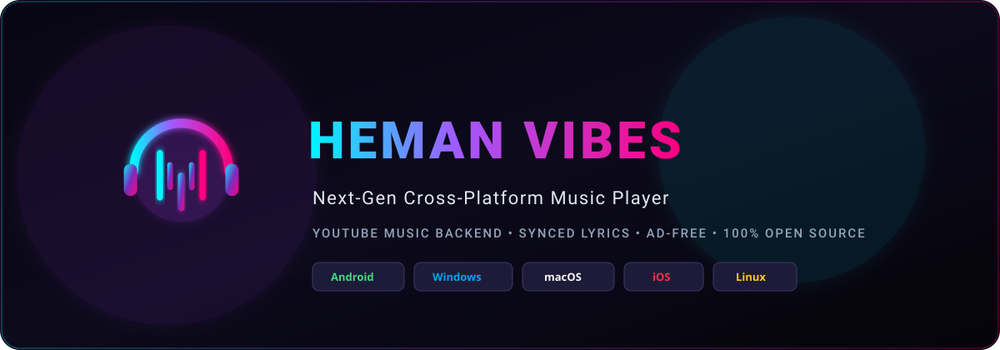
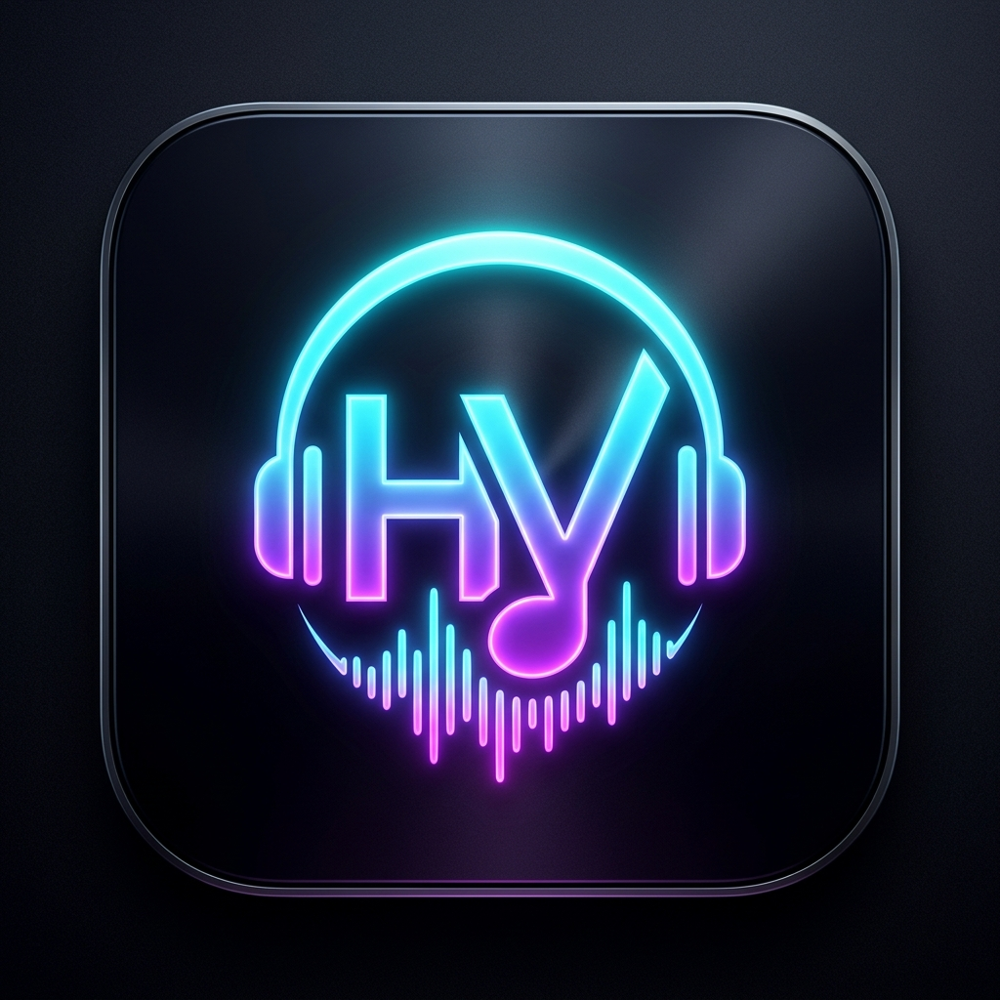

<div align="center">



# 🎵 HeMan Vibes

**Next-Gen Cross-Platform Music Player powered by Compose Multiplatform & YouTube Music**

*Crafted with ❤️ by [Heman Subedi](https://github.com/hemansubedi10)*

[](https://github.com/hemansubedi10/HeManVibes/releases/latest)
[](https://github.com/hemansubedi10/HeManVibes/actions)
[](https://kotlinlang.org/)
[](https://www.jetbrains.com/lp/compose-multiplatform/)
[](./LICENSE)

<br/>

<p align="center">
  
</p>

### 📥 One-Click Direct Downloads

Click below to download HeMan Vibes directly for your device:

<p align="center">
  <a href="https://github.com/hemansubedi10/HeManVibes/releases/download/v1.0.0/HeManVibes-v1.0.0-android-universal.apk">
    
  </a>
  &nbsp;
  <a href="https://github.com/hemansubedi10/HeManVibes/releases/download/v1.0.0/HeManVibes-v1.0.0-windows-x64.exe">
    
  </a>
  &nbsp;
  <a href="https://github.com/hemansubedi10/HeManVibes/releases/download/v1.0.0/HeManVibes-v1.0.0-macos-universal.dmg">
    
  </a>
  &nbsp;
  <a href="https://github.com/hemansubedi10/HeManVibes/releases/download/v1.0.0/HeManVibes-v1.0.0-linux-x64.deb">
    
  </a>
</p>

[**👉 View All Release Assets & Changelogs**](https://github.com/hemansubedi10/HeManVibes/releases/latest)

</div>

---

## 🌟 Overview

**HeMan Vibes** is an ultra-fast, modern, open-source music streaming application designed to run seamlessly across all your devices — **Android, Windows, macOS, iOS, and Linux**.

Built using **Kotlin Multiplatform (KMP)** and **Compose Multiplatform (CMP)** with a single shared UI and business logic, HeMan Vibes extracts audio directly from **YouTube Music's InnerTube API** and pairs it with real-time synchronized lyrics via **LRCLIB** — offering an ad-free, high-fidelity listening experience.

---

## 📦 Direct Download Matrix

| Platform | Supported Architecture | File Type | Direct Download Link |
| :--- | :--- | :--- | :--- |
| **🤖 Android** | ARM64, ARMv7, x86_64 | `.apk` | [**Download APK (Direct)**](https://github.com/hemansubedi10/HeManVibes/releases/download/v1.0.0/HeManVibes-v1.0.0-android-universal.apk) |
| **🪟 Windows** | 64-bit (x64) | `.exe` / `.msi` | [**Download Setup.exe (Direct)**](https://github.com/hemansubedi10/HeManVibes/releases/download/v1.0.0/HeManVibes-v1.0.0-windows-x64.exe) |
| **🍎 macOS** | Apple Silicon (M1/M2/M3/M4) & Intel | `.dmg` | [**Download macOS DMG (Direct)**](https://github.com/hemansubedi10/HeManVibes/releases/download/v1.0.0/HeManVibes-v1.0.0-macos-universal.dmg) |
| **🐧 Linux** | Ubuntu, Debian, Mint (x64) | `.deb` | [**Download Linux DEB (Direct)**](https://github.com/hemansubedi10/HeManVibes/releases/download/v1.0.0/HeManVibes-v1.0.0-linux-x64.deb) |
| **📱 iOS** | iOS 16.0+ (iPhone & iPad) | Xcode / Sideload | [**iOS Build Instructions**](#-ios-iphone--ipad) |

---

## ✨ Features & Interface Showcase

- 🎧 **Unlimited YouTube Music Catalog:** Direct access to YouTube Music's global catalog with zero advertisements.
- 🌊 **Material 3 Expressive Wavy Seek Bar:** Animated fluid sine wave ripples in real-time during playback and flattens smoothly when paused.
- 🎨 **Apple Music-Style Mesh Backdrop:** Fluid ambient multi-color radial gradient orbs that drift gently in sync with playback.
- ⚡ **Live Search Suggestions:** Real-time YouTube search suggestions pop up as you type with instant tap-to-complete.
- 🎤 **Karaoke Synced Lyrics:** Millisecond-accurate timestamped lyrics from [LRCLIB](https://lrclib.net/) with active line neon glow and **Tap-to-Seek**.
- 🔀 **Up Next Queue:** Slide-up sheet to inspect your active queue, reorder, and jump to any track.
- 🌙 **Sleep Timer:** Automatic playback sleep timers (15m, 30m, 45m, 60m).
- 🔊 **High-Fidelity Audio:** Streams Opus (@ 160 kbps) and AAC (@ 128 kbps) direct from Google CDN.
- 🖤 **Obsidian AMOLED Dark Theme:** Pure battery-saving dark palette with `#00F5FF` electric cyan and `#FF007F` neon pink accents.

---

## 📱 Platform Guides

<details open>
<summary><b>🤖 Android</b></summary>

### Features
* Native ExoPlayer integration via **AndroidX Media3**.
* Background playback service and lock-screen notification media controls.
* Android Auto & Bluetooth audio metadata streaming.

### Quick Install
1. Download the [**HeManVibes Android APK**](https://github.com/hemansubedi10/HeManVibes/releases/download/v1.0.0/HeManVibes-v1.0.0-android-universal.apk).
2. Tap the downloaded file to install on your phone.
3. (If prompted, allow "Install from Unknown Sources").

### Developer Build
```bash
# Debug APK
./gradlew :androidApp:assembleDebug

# Install directly to connected device / emulator
./gradlew :androidApp:installDebug
```
</details>

<details open>
<summary><b>🪟 Windows (PC)</b></summary>

### Features
* Desktop native window with fluid resizing, minimize-to-tray, and system media keys.
* Full keyboard shortcuts (`Space` for play/pause, `Left`/`Right` to seek).

### Quick Install
1. Download [**HeManVibes-v1.0.0-windows-x64.exe**](https://github.com/hemansubedi10/HeManVibes/releases/download/v1.0.0/HeManVibes-v1.0.0-windows-x64.exe).
2. Run the installer and launch **HeMan Vibes** from your Start Menu.

### Developer Build
```bash
# Run in development
.\gradlew.bat :desktopApp:run

# Package Windows MSI installer
.\gradlew.bat :desktopApp:packageMsi
```
</details>

<details open>
<summary><b>🍎 macOS</b></summary>

### Features
* Native Apple Silicon (M1/M2/M3/M4) & Intel DMG package.
* macOS Now Playing Control Center integration.

### Quick Install
1. Download [**HeManVibes-v1.0.0-macos-universal.dmg**](https://github.com/hemansubedi10/HeManVibes/releases/download/v1.0.0/HeManVibes-v1.0.0-macos-universal.dmg).
2. Drag **HeMan Vibes** into your `/Applications` folder.

### Developer Build
```bash
./gradlew :desktopApp:packageDmg
```
</details>

<details open>
<summary><b>📱 iOS (iPhone & iPad)</b></summary>

### Features
* Compose Multiplatform UI rendered natively using Skiko.
* AVQueuePlayer background audio with `MPRemoteCommandCenter` and Dynamic Island support.

### Sideload / Run
Open the `iosApp` folder in Xcode on macOS:
```bash
open iosApp/iosApp.xcodeproj
```
Select your iOS Simulator or connected iPhone and click **Run**.
</details>

<details>
<summary><b>🐧 Linux</b></summary>

### Quick Install
```bash
sudo dpkg -i HeManVibes-v1.0.0-linux-x64.deb
```
</details>

---

## 🏗️ Architecture

HeMan Vibes follows **Clean Architecture** principles across all targets:

```
┌────────────────────────────────────────────────────────────────────────┐
│                   Shared Compose Multiplatform UI                      │
│   (HomeScreen, SearchScreen, LibraryScreen, NowPlayingScreen)          │
└───────────────────────────────────┬────────────────────────────────────┘
                                    │ StateFlow / Events
┌───────────────────────────────────▼────────────────────────────────────┐
│                    Shared Domain & ViewModels                          │
│               (AudioPlayer, SearchEngine, LyricsEngine)                │
└───────────────────┬─────────────────────────────────┬──────────────────┘
                    │                                 │
┌───────────────────▼─────────────┐     ┌─────────────▼──────────────────┐
│      Scraper & API Layer        │     │      Audio Player Engine       │
│  • YouTube InnerTube API        │     │     (expect/actual interface)  │
│  • LRCLIB Synced Lyrics Client  │     └─────────────┬──────────────────┘
└─────────────────────────────────┘                   │
                                        ┌─────────────┴─────────────┐
                                        ▼                           ▼
                                Android Media3              iOS AVPlayer
                                (ExoPlayer)                 Desktop JavaFX / VLC
```

For full details, see the [Architecture Guide](./docs/ARCHITECTURE.md) and [Product Roadmap](./docs/ROADMAP.md).

---

## 🚀 Tech Stack

| Technology | Purpose |
| :--- | :--- |
| **Kotlin 2.1.0** | Core programming language |
| **Compose Multiplatform 1.7.1** | Declarative cross-platform UI |
| **Ktor 3.0.1** | Multiplatform asynchronous HTTP engine |
| **Kotlinx Serialization** | High-performance JSON parsing |
| **Coil 3** | Asynchronous image loading & disk caching |
| **AndroidX Media3** | Android audio playback engine & ExoPlayer |
| **LRCLIB API** | Free, open-source synced LRC lyrics provider |

---

## 📄 License

This project is licensed under the MIT License — see the [LICENSE](./LICENSE) file for details.

```
Copyright (c) 2026 Heman Subedi. All rights reserved.
```
