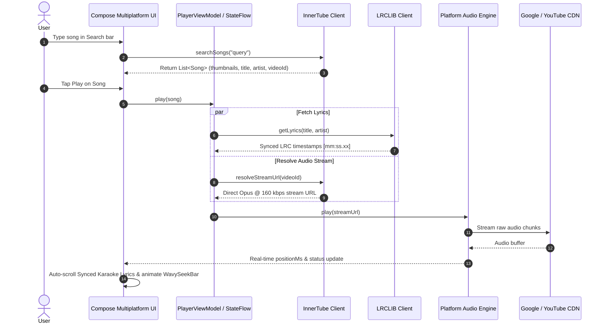

# 🏛️ Architecture Documentation — HeMan Vibes

This document provides an in-depth breakdown of the architecture, design patterns, and data pipelines powering **HeMan Vibes** across Android, iOS, Windows, macOS, and Linux.

---

## 🎯 Architecture Goals

1. **100% Shared UI & Business Logic:** Single Compose Multiplatform codebase for all user-facing interfaces.
2. **Native Performance:** Platform-native audio rendering (`ExoPlayer` on Android, `AVQueuePlayer` on iOS, and `VLC / JavaFX` on Desktop) ensures zero lag, high efficiency, and native lock-screen controls.
3. **Resilient Extraction Pipeline:** Multi-tier YouTube Music InnerTube scraper with automatic fallback to prevent playback disruption when YouTube updates its protocols.

---

## 🔄 Sequence: Search to Playback Pipeline



---

## 📦 Module Hierarchy

```
HeManVibes/
├── composeApp/
│   ├── commonMain/
│   │   ├── model/           # Song, Playlist, Lyrics, PlaybackState
│   │   ├── network/         # InnerTubeClient, LyricsClient
│   │   ├── player/          # AudioPlayer expect declaration
│   │   └── ui/
│   │       ├── components/  # WavySeekBar, MeshBackdrop, MiniPlayer, SongRow
│   │       ├── screens/     # HomeScreen, SearchScreen, LibraryScreen, NowPlayingScreen, SettingsScreen
│   │       └── theme/       # Cyber-dark palette, Typography, M3 styling
│   ├── androidMain/         # AndroidAudioPlayer (Media3 ExoPlayer + MediaSession)
│   ├── desktopMain/         # DesktopAudioPlayer (JVM bindings)
│   └── iosMain/             # IosAudioPlayer (AVPlayer + MPRemoteCommandCenter)
├── androidApp/              # Android Application launcher & Manifest
├── desktopApp/              # Desktop distribution packaging (.msi, .exe, .dmg, .deb)
└── iosApp/                  # Xcode iOS launcher
```

---

## 🛡️ Audio Quality Standards

| Codec | Format | Bitrate | Sample Rate | Container |
| :--- | :--- | :--- | :--- | :--- |
| **Opus** (Primary) | itag 251 | ~160 kbps | 48.0 kHz | WebM |
| **AAC** (Fallback) | itag 140 | ~128 kbps | 44.1 kHz | M4A |

---

## 📄 License & Attribution

Architected and developed by **Heman Subedi** under the [MIT License](../LICENSE).
